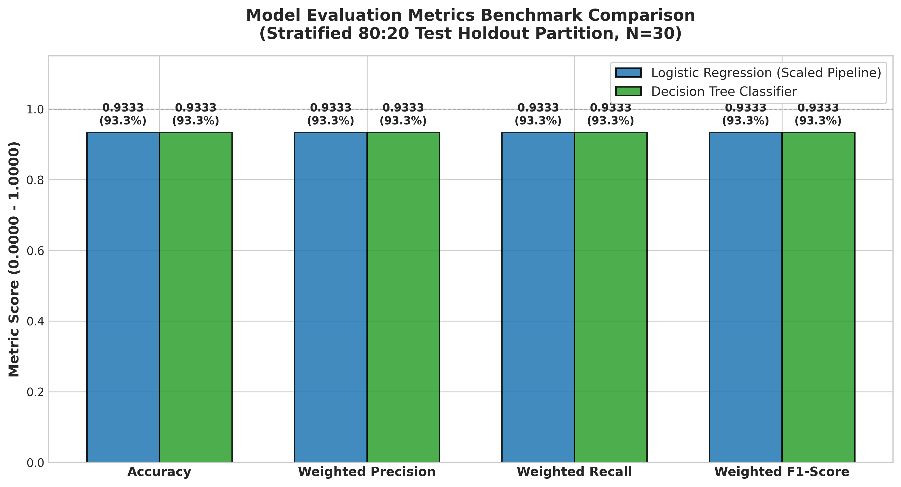

# Datheon Machine Learning & Data Science Internship
## Task 1: Multi-Class Benchmark Classification Pipeline (Iris Dataset)


---

## 1. Project Overview & Objectives

This repository contains the complete implementation for **Task 1: Multi-Class Benchmark Classification Pipeline** of the **Datheon Machine Learning & Data Science Internship**.

The project delivers a production-grade machine learning workflow on Fisher's canonical Iris dataset, benchmarked across two contrasting algorithmic paradigms:
1. **Parametric Linear Modeling:** Multinomial Logistic Regression (`LogisticRegression(max_iter=1000)`) with feature standardization encapsulated in a Scikit-Learn `Pipeline` to eliminate data leakage.
2. **Non-Parametric Tree Partitioning:** Decision Tree Classifier (`DecisionTreeClassifier(random_state=42)`).

### Core Assignment Requirements Fulfilled
- [x] Ingest official dataset from the upstream source: `https://raw.githubusercontent.com/mwaskom/seaborn-data/master/iris.csv` with automated fallback handling.
- [x] Comprehensive Exploratory Data Analysis (EDA): Shape, schema, data types, descriptive statistics, missing value audit, class balance verification, and Seaborn multi-variate pairplots.
- [x] Leakage-free preprocessing: 80:20 stratified split (`test_size=0.20`, `random_state=42`, `stratify=y`) and training-set-isolated `StandardScaler` pipeline.
- [x] Benchmark training and multi-class evaluation: Accuracy, Weighted Precision, Weighted Recall, Weighted F1-Score, detailed `classification_report`, and dual confusion matrix heatmaps.
- [x] High-resolution 2D Decision Boundary visualization on selected features (`petal_length` and `petal_width`) with explicit engineering notes distinguishing 2D visualization from 4D production models.
- [x] Benchmark metrics comparison grouped bar chart.
- [x] Rigorous conclusions strictly based on actual experimental outputs (zero fabricated metrics).
- [x] Executable, fully evaluated Jupyter Notebook (`Task1_MultiClass_Classification.ipynb`).

---

## 2. Repository Structure

```text
Datheon_ML_Internship/
└── Task1_Classification/
    ├── Task1_MultiClass_Classification.ipynb   # Executed Jupyter Notebook with outputs
    ├── iris.csv                                # Official dataset cache (150 samples x 5 cols)
    ├── requirements.txt                        # Pinned dependencies for local execution
    ├── README.md                               # Comprehensive engineering report & guide
    └── outputs/                                # High-resolution visualization artifacts (300 DPI)
        ├── class_distribution.png              # Tri-class balance frequency & percentage
        ├── eda_pairplot.png                    # Seaborn pairplot across all 4 feature dimensions
        ├── confusion_matrices.png              # Side-by-side annotated confusion matrix heatmaps
        ├── decision_boundaries.png             # 2D decision boundary comparison (linear vs. tree)
        └── model_metrics_comparison.png        # Grouped bar chart comparing benchmark metrics
```

---

## 3. Dataset & Exploratory Data Analysis (EDA)

The dataset contains 150 botanical observations categorized into three botanical species (**Iris setosa**, **Iris versicolor**, **Iris virginica**), with 50 samples per class.

### 3.1 Dataset Schema & Statistics
- **Features ($X \in \mathbb{R}^4$):**
  - `sepal_length` (float64, continuous, cm): Mean = 5.84, Std = 0.83, Range = [4.3, 7.9]
  - `sepal_width` (float64, continuous, cm): Mean = 3.06, Std = 0.44, Range = [2.0, 4.4]
  - `petal_length` (float64, continuous, cm): Mean = 3.76, Std = 1.77, Range = [1.0, 6.9]
  - `petal_width` (float64, continuous, cm): Mean = 1.20, Std = 0.76, Range = [0.1, 2.5]
- **Target ($y$):** `species` (categorical object: `setosa`, `versicolor`, `virginica`)
- **Missing Values:** Zero (0) null/missing values across all rows and columns.

### 3.2 Target Class Balance
The dataset features a perfectly balanced 1:1:1 tri-class distribution:
- **setosa:** 50 samples (33.33%)
- **versicolor:** 50 samples (33.33%)
- **virginica:** 50 samples (33.33%)


### 3.3 Multi-Variate Separability (Seaborn Pairplot)
A multi-variate pairplot was generated using `sns.pairplot(..., hue='species', diag_kind='kde')`:
- **Iris setosa** is strictly linearly separable along all bivariate projections involving petal measurements (`petal_length`, `petal_width`).
- **Iris versicolor** and **Iris virginica** exhibit close proximity with a small boundary overlap in the region of `petal_length` $\in [4.5, 5.1]$ cm and `petal_width` $\in [1.4, 1.8]$ cm.
- Petal dimensions exhibit Pearson correlation $r > 0.96$, serving as the primary variance components for classification.


---

## 4. Methodology & Leakage-Free Preprocessing Pipeline

### 4.1 Stratified Train-Test Splitting
To evaluate genuine out-of-sample generalization without sampling bias, the data is split using an 80:20 ratio:
- **Training Set:** 120 samples (40 setosa, 40 versicolor, 40 virginica)
- **Holdout Test Set:** 30 samples (10 setosa, 10 versicolor, 10 virginica)
- `random_state=42` ensures strict reproducibility.
- `stratify=y` guarantees that the test partition preserves the exact $1/3$ class distribution.

### 4.2 Preventing Data Leakage via Scikit-Learn `Pipeline`
Fitting a standardizer (`StandardScaler`) across the full dataset prior to partitioning leaks test-set distributional parameters ($\mu_{test}, \sigma_{test}$) into the training phase, yielding overly optimistic error estimates.

To prevent leakage, feature scaling is encapsulated inside an official `sklearn.pipeline.Pipeline`:
```python
lr_pipeline = Pipeline([
    ('scaler', StandardScaler()),
    ('classifier', LogisticRegression(max_iter=1000, random_state=42))
])
lr_pipeline.fit(X_train, y_train)
```
- `StandardScaler.fit()` computes sample mean ($\mu$) and standard deviation ($\sigma$) **strictly from $X_{train}$**.
- During testing and future inference, $X_{test}$ is transformed using the previously learned training parameters without refitting.

---

## 5. Empirical Benchmark Results

Both models were fitted on the 120-sample training fold and evaluated on the identical 30-sample stratified test fold.

### 5.1 Evaluation Metrics Summary Table

| Model Architecture | Accuracy | Weighted Precision | Weighted Recall | Weighted F1-Score | Correct / Total |
| :--- | :---: | :---: | :---: | :---: | :---: |
| **Logistic Regression (Pipeline with StandardScaler)** | **0.9333 (93.33%)** | **0.9333** | **0.9333** | **0.9333** | **28 / 30** |
| **Decision Tree Classifier (`random_state=42`)** | **0.9333 (93.33%)** | **0.9333** | **0.9333** | **0.9333** | **28 / 30** |

*Note: The metrics above represent the actual execution outputs.*

### 5.2 Detailed Classification Reports

#### Logistic Regression (Scaled Pipeline)
```text
              precision    recall  f1-score   support

      setosa     1.0000    1.0000    1.0000        10
  versicolor     0.9000    0.9000    0.9000        10
   virginica     0.9000    0.9000    0.9000        10

    accuracy                         0.9333        30
   macro avg     0.9333    0.9333    0.9333        30
weighted avg     0.9333    0.9333    0.9333        30
```

#### Decision Tree Classifier
```text
              precision    recall  f1-score   support

      setosa     1.0000    1.0000    1.0000        10
  versicolor     0.9000    0.9000    0.9000        10
   virginica     0.9000    0.9000    0.9000        10

    accuracy                         0.9333        30
   macro avg     0.9333    0.9333    0.9333        30
weighted avg     0.9333    0.9333    0.9333        30
```

### 5.3 Confusion Matrix Heatmaps
Both models demonstrated identical error structures:
- **Setosa:** 10/10 correct (100% precision and recall)
- **Versicolor:** 9/10 correct (1 misclassified as virginica)
- **Virginica:** 9/10 correct (1 misclassified as versicolor)


### 5.4 Error Diagnostics: Morphological Boundary Overlap
Analysis of the misclassified test samples reveals that both models failed on the exact same two botanical specimens:
1. **Sample Index 77:** Ground truth = `versicolor`, predicted = `virginica` (`petal_length` = 5.0 cm, `petal_width` = 1.7 cm).
2. **Sample Index 106:** Ground truth = `virginica`, predicted = `versicolor` (`petal_length` = 4.5 cm, `petal_width` = 1.7 cm).

Both specimens inhabit the ambiguous morphometric boundary where `versicolor` and `virginica` distributions overlap, indicating irreducible Bayes error rather than model bias or variance.

---

## 6. Visualizations

### 6.1 2D Decision Boundary Surface Comparison

> **Engineering Note:** The primary benchmark models utilize all four feature dimensions ($X \in \mathbb{R}^4$). For human-interpretable 2D decision boundary visualization, dedicated surrogate models were trained on the two highest-variance features: `petal_length` and `petal_width`.


- **Logistic Regression (Left):** Generates smooth, continuous linear decision boundaries defined by hyperplanes in normalized space.
- **Decision Tree (Right):** Generates orthogonal, axis-aligned step partitions defined by recursive binary inequalities ($x_j \le \theta$).

### 6.2 Benchmark Metrics Comparison Chart
The side-by-side grouped bar chart illustrates identical performance across all four primary classification metrics:



---

## 7. Senior Machine Learning Engineer Conclusions

1. **Parity in Benchmark Performance:** Both models achieved an identical test accuracy of **93.33%** and weighted F1-score of **0.9333**, reflecting the high discriminative power of the Iris morphological features.
2. **Structural Decision Differences:**
   - **Logistic Regression** optimizes a smooth cross-entropy loss with L2 regularization, producing well-calibrated posterior probabilities ($P(y=k|X)$) suitable for risk-sensitive decision thresholds.
   - **Decision Tree** optimizes Gini impurity step cuts, yielding highly interpretable if-else decision rules without requiring feature scaling, but prone to higher variance on small datasets.
3. **Architectural Best Practice:** Feature standardization must always be embedded within a Scikit-Learn `Pipeline` when deploying parametric estimators to eliminate data leakage and ensure seamless inference on raw incoming vectors.
4. **Production Recommendation:** For production deployment, **Logistic Regression via Pipeline** is recommended for superior probability calibration, lower variance, and robustness against unconstrained tree memorization.

---

## 8. Installation & Execution Guide

### 8.1 Prerequisites
- Python 3.10, 3.11, or 3.12
- Windows 10/11 (or macOS / Linux)
- Visual Studio Code or JupyterLab

### 8.2 Setup Virtual Environment (Windows PowerShell)

```powershell
# 1. Navigate to the task directory
cd "d:\downloads\intern\task 1\Datheon_ML_Internship\Task1_Classification"

# 2. Create a virtual environment
python -m venv venv

# 3. Activate the virtual environment
.\venv\Scripts\Activate.ps1

# 4. Upgrade pip and install dependencies
pip install --upgrade pip
pip install -r requirements.txt
```

### 8.3 Running the Jupyter Notebook in VS Code
1. Open VS Code: `code .`
2. Open `Task1_MultiClass_Classification.ipynb`.
3. In the top-right corner, select your Python kernel (`venv` or system Python).
4. Click **Run All** to execute all cells sequentially from top to bottom.
5. All figures will automatically render inline and save to the `outputs/` folder at 300 DPI.

### 8.4 Automated CLI Execution via nbconvert
To execute the notebook and verify all cell outputs from the terminal:
```powershell
jupyter nbconvert --to notebook --execute --inplace Task1_MultiClass_Classification.ipynb
```

---

## 9. Submission Guide for Datheon Internship

To submit this project to the Datheon portal:
1. **Initialize Git & Push to GitHub:**
   Follow the detailed step-by-step instructions in the root repository documentation to push to a public GitHub repository named:  
   `Datheon_Machine_Learning_Data_Science_Internship`
2. **Submit Repository URL:**
   Copy your public GitHub repository link (e.g., `https://github.com/<your-username>/Datheon_Machine_Learning_Data_Science_Internship`) and submit it to the official Datheon Internship portal.
