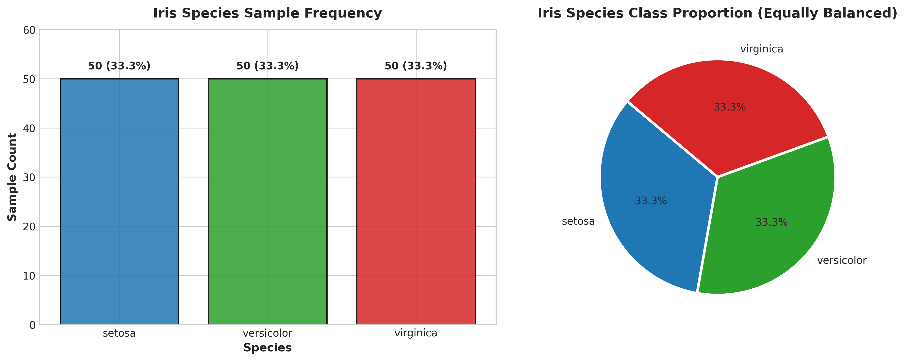
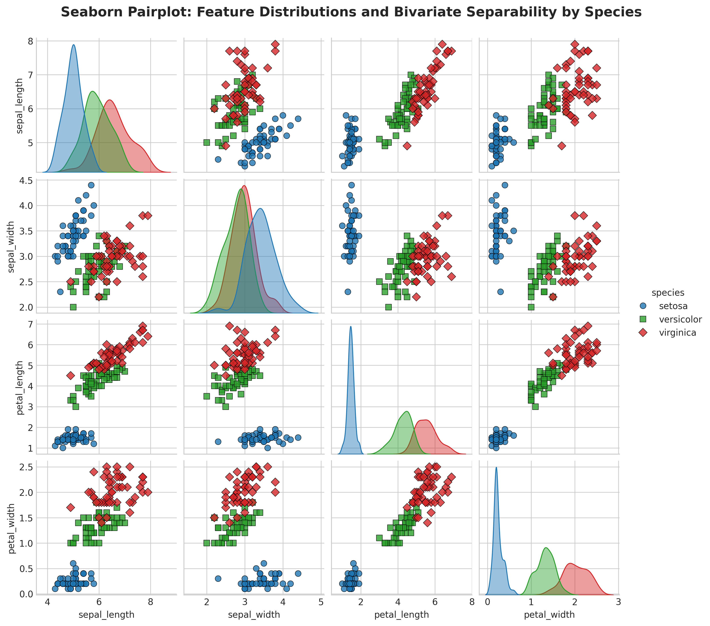
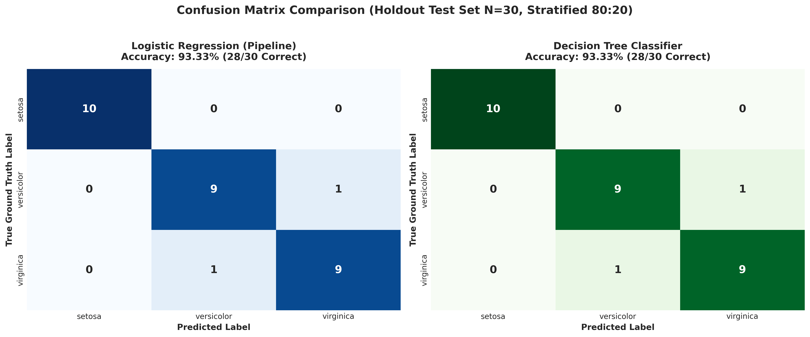
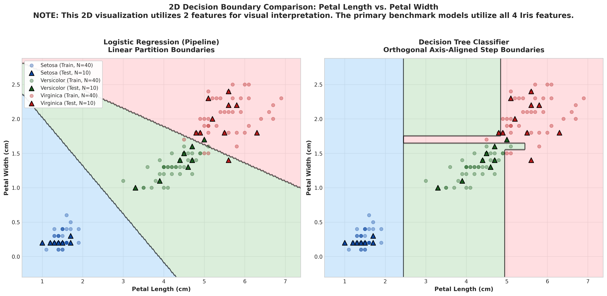

# Datheon Machine Learning & Data Science Internship

[](https://www.python.org/)
[](https://scikit-learn.org/)
[](https://pandas.pydata.org/)
[](https://numpy.org/)
[](https://jupyter.org/)
[](https://github.com/)

This repository hosts the official deliverables, machine learning pipelines, and benchmark evaluations for the **Datheon Machine Learning & Data Science Internship**.

---

## Repository Table of Contents

| Task | Title | Focus Area | Status | Deliverable Link |
| :---: | :--- | :--- | :---: | :--- |
| **Task 1** | **Multi-Class Benchmark Classification Pipeline (Iris Dataset)** | Ingestion, EDA, Data Leakage Prevention, Logistic Regression vs. Decision Tree, 2D Decision Boundaries | **Completed & Validated** | [Explore Task 1](Datheon_ML_Internship/Task1_Classification/) |

---

## Task 1 Executive Summary: Multi-Class Benchmark Classification

### Objective
Design and implement an end-to-end, multi-class classification benchmarking pipeline on the Iris dataset that adheres to senior machine learning engineering best practices:
- **Resilient Data Ingestion:** Automated download from the official Seaborn data repository with local fallback caching.
- **Exploratory Data Analysis (EDA):** Statistical profiling, missing value verification, tri-class balance validation, and 4D pairplot analysis.
- **Data Leakage Mitigation:** Stratified 80:20 partitioning (`random_state=42`) with feature scaling (`StandardScaler`) strictly confined inside a Scikit-Learn `Pipeline`.
- **Model Benchmarking:** Contrasting parametric linear modeling (**Logistic Regression**) against non-parametric hierarchical partitioning (**Decision Tree Classifier**).
- **Comprehensive Evaluation:** Accuracy, Weighted Precision, Weighted Recall, Weighted F1-score, Scikit-Learn classification reports, and annotated confusion matrix heatmaps.
- **2D Decision Boundary Surface Visualizations:** Spatial decision boundary contour plots comparing linear hyperplanes with orthogonal step cuts on `petal_length` and `petal_width`.

### Benchmark Results (Holdout Test Partition, N=30)

| Metric | Logistic Regression (Scaled Pipeline) | Decision Tree Classifier (`random_state=42`) |
| :--- | :---: | :---: |
| **Accuracy** | **93.33% (28/30)** | **93.33% (28/30)** |
| **Weighted Precision** | **0.9333** | **0.9333** |
| **Weighted Recall** | **0.9333** | **0.9333** |
| **Weighted F1-Score** | **0.9333** | **0.9333** |
| **Setosa Performance** | **100% Precision / Recall** | **100% Precision / Recall** |

### Key Visualizations

<div align="center">
  <table>
    <tr>
      <td width="50%"><b>Tri-Class Balance</b></td>
      <td width="50%"><b>Seaborn 4D Pairplot</b></td>
    </tr>
    <tr>
      <td></td>
      <td></td>
    </tr>
    <tr>
      <td width="50%"><b>Confusion Matrix Heatmaps</b></td>
      <td width="50%"><b>2D Decision Boundaries</b></td>
    </tr>
    <tr>
      <td></td>
      <td></td>
    </tr>
  </table>
</div>

---

## Project Structure

```text
Datheon_Machine_Learning_Data_Science_Internship/
├── .gitignore                                  # Git exclusion rules
├── README.md                                   # Root project overview & navigation
└── Datheon_ML_Internship/
    └── Task1_Classification/
        ├── Task1_MultiClass_Classification.ipynb # Fully executed Jupyter Notebook
        ├── iris.csv                            # Cached dataset
        ├── requirements.txt                    # Python dependencies
        ├── README.md                           # Detailed task report & methodology
        └── outputs/                            # Exported 300 DPI figures
            ├── class_distribution.png
            ├── eda_pairplot.png
            ├── confusion_matrices.png
            ├── decision_boundaries.png
            └── model_metrics_comparison.png
```

---

## Quickstart & Execution Guide

### 1. Clone the Repository
```bash
git clone https://github.com/<your-username>/Datheon_Machine_Learning_Data_Science_Internship.git
cd Datheon_Machine_Learning_Data_Science_Internship
```

### 2. Environment Setup (Windows PowerShell)
```powershell
# Create and activate virtual environment
python -m venv venv
.\venv\Scripts\Activate.ps1

# Install required dependencies
pip install --upgrade pip
pip install -r Datheon_ML_Internship/Task1_Classification/requirements.txt
```

### 3. Run the Notebook
Open in VS Code or launch JupyterLab:
```bash
jupyter lab Datheon_ML_Internship/Task1_Classification/Task1_MultiClass_Classification.ipynb
```
Or execute headlessly from the CLI:
```powershell
cd Datheon_ML_Internship/Task1_Classification
jupyter nbconvert --to notebook --execute --inplace Task1_MultiClass_Classification.ipynb
```

---

## Internship Submission Steps

1. **Verify Local Repository:** Ensure all outputs are generated and the notebook has run with zero errors.
2. **Push to GitHub:** Follow the GitHub push guide to upload this repository to your personal GitHub profile.
3. **Submit URL to Datheon:** Submit the link to your public repository on the Datheon internship portal.
